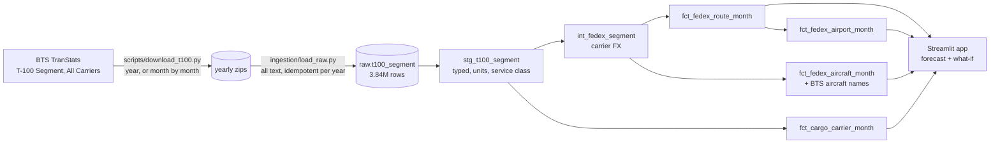

# FedEx Air Network

**What public flight data says about how FedEx Express runs its air network: where the cargo goes, how full the
aircraft fly, how the fleet is changing, what the next year looks like, and how much slack the network has if
Memphis loses capacity.**

Every FedEx Express flight segment reported to the U.S. Department of Transportation from January 2019 to August
2026 (BTS T-100, 3.84 million rows across all carriers), modeled in dbt + DuckDB and explored in a Streamlit app.

**Live app: [fedex-air-network.streamlit.app](https://fedex-air-network-rmcm8wjsjqpl3g2vehamfe.streamlit.app/)**

## Findings

| | |
|---|---|
| **UPS overtook FedEx in U.S. domestic air cargo** | In 92 months of data, UPS carried more domestic air cargo than FedEx for the first time in **October 2024**, and in **every one of the 23 months since**. FedEx domestic cargo fell **22%** in the 12 months after (10.26 → 8.04 billion lbs) while UPS rose **25%** (7.27 → 9.07 billion lbs). The timing matches the publicly reported end of FedEx's U.S. Postal Service air contract in September 2024; T-100 does not identify shippers, so the data shows the shift, not its cause. |
| **FedEx cut capacity in step with demand** | From the 2021 peak to 2025, cargo fell **31%** (14.71 → 10.20 billion lbs) and payload capacity flown fell **31%** (28.65 → 19.65 billion lbs), so aircraft stayed **49-52% full** by weight every year. Volume leveled off in 2026 (Jan-Aug +1.3% vs. 2025). |
| **Memphis is the network** | **63-70%** of all FedEx air cargo departs or arrives at MEM; Indianapolis is second at 15-18%. International routes grew from 14% to 22% of cargo (2019 to 2025) as domestic shrank. |
| **The fleet is modernizing** | 2019 to 2025: MD-11 departures **-67%**, A300 **-54%**, DC-10 retired by 2023, while 777F departures rose **51%**. The 767-300 is the workhorse (71K departures, 5.0 billion lbs in 2025). |
| **Memphis has more backup cushion than it used to** | Using only lift that already flew empty out of IND, OAK, EWR and ANC, the network could absorb about **40%** of Memphis's outbound cargo in its busiest month (July 2020), but about **61%** by December 2025. |
| **The forecast held up on months it never saw** | Fit on data through December 2025, the chosen method (current level x typical seasonality) missed January-August 2026 by **4.0% a month** on average and **0.4%** on the eight-month total ([details](#forecast)). |

## Questions a planner would ask, and where the app answers them

| Tab | Question |
|---|---|
| Network | How much cargo, how many departures, how full, and how seasonal (each month vs. its year's average)? |
| Hubs | Which airports handle the most cargo in a year, and which routes carry it? |
| Fleet | Which aircraft types carry the cargo, how big are they per departure and how full do they fly? |
| Peers | How does FedEx compare with UPS, Atlas, ATI and Kalitta, overall and in the domestic market? |
| Forecast | What will the next 12 months look like, and how wrong has each method been? |
| Hub disruption what-if | If a hub loses X% of capacity in a month, can empty lift at chosen backup hubs absorb it? |

## How it works



- **Download.** TranStats is an ASP.NET form: the script reads its view state and posts the year and the 28
  columns used. A whole year sometimes takes the server longer to build than it will wait, so the script falls
  back to 12 monthly requests and stitches them into the same file; the current year stops at the latest month
  BTS has published.
- **Raw, untouched.** Every carrier is kept (the peers are the benchmark), loaded as text. Reloading a year
  replaces it; a file containing rows from another year is refused.
- **Tested models.** Uniqueness of every mart's grain, non-negative weights, no missing months, and two
  reconciliations: every pound of FedEx freight and mail in the raw files reaches the route fact month by month,
  and airport throughput is exactly twice route cargo (each pound leaves one airport and arrives at another).

## Forecast

Four explainable methods, chosen by backtest on the last 12 months they never saw:

| Method | Backtest on 2024 | Backtest on 2025 | Out of sample, Jan-Aug 2026 |
|---|---|---|---|
| Current level x typical seasonality (chosen) | 7.5% | **8.2%** | **4.0%** (total -0.4%) |
| Same month last year | 8.5% | 19.4% | 3.7% (total -1.3%) |
| 3-month average | 9.2% | 11.1% | 5.5% (total +3.1%) |
| Last year x trend | 10.2% | 17.0% | 17.0% (total -17.1%) |

Mean absolute percentage error per month. In a stable year (backtest on 2023) "last year x trend" was best at
4.4%; after the 2024 break it was worst, because it carries last year's level forward. "Level x seasonality"
re-anchors on the latest three months, which is why it was chosen. On 2026 the simple "same month last year" was
slightly better month to month once the network had settled.

## What this data cannot tell you

- **No packages, revenue or costs**: T-100 reports weight, capacity, departures and time, not shipments.
- **No ground network**: trucks and sort operations are invisible.
- **Scheduled vs. performed is not a reliability measure here**: FedEx reports them as equal in every year (one
  departure apart in 2021, out of 313,838), so a completion rate would always read 100%. It was dropped rather
  than shown.
- **Small aircraft are pooled**: BTS lets FedEx report many small feeder aircraft under one code.
- **The what-if counts existing empty lift only**, at the hub level; destinations, timing, crews and sort capacity
  would decide real feasibility. It is a first-pass screen, not a routing model.

## Run it

```bash
uv sync
python3 scripts/download_t100.py 2019 2026          # ~100 MB of zips into data/raw (not committed)
uv run python -m ingestion.load_raw
cd transform && uv run dbt build --profiles-dir . && cd ..
uv run streamlit run app/app.py
```

Without `data/`, the app reads `demo/network.duckdb` (4.7 MB, the four marts), which is what the hosted app uses.

## Tests

- **dbt (13):** grain uniqueness on all four marts, not-null and non-negative weights, complete months, freight
  and mail reconciled to raw by month, airport throughput = 2 x route cargo.
- **pytest (8):** the loader (text types, idempotent reload, wrong-year files refused); each forecast method,
  including recovery after a structural break; the backtest picking the right method; the what-if arithmetic and
  input checks.

## Tech

Python · dbt · DuckDB · SQL · pandas · Streamlit · Altair · pytest · ruff · GitHub Actions

Data: U.S. Department of Transportation, Bureau of Transportation Statistics,
[T-100 Segment (All Carriers)](https://www.transtats.bts.gov/DL_SelectFields.aspx?gnoyr_VQ=FMG&QO_fu146_anzr=Nv4%20Pn44vr45),
January 2019 to August 2026. Independent analysis; not affiliated with or endorsed by FedEx.
